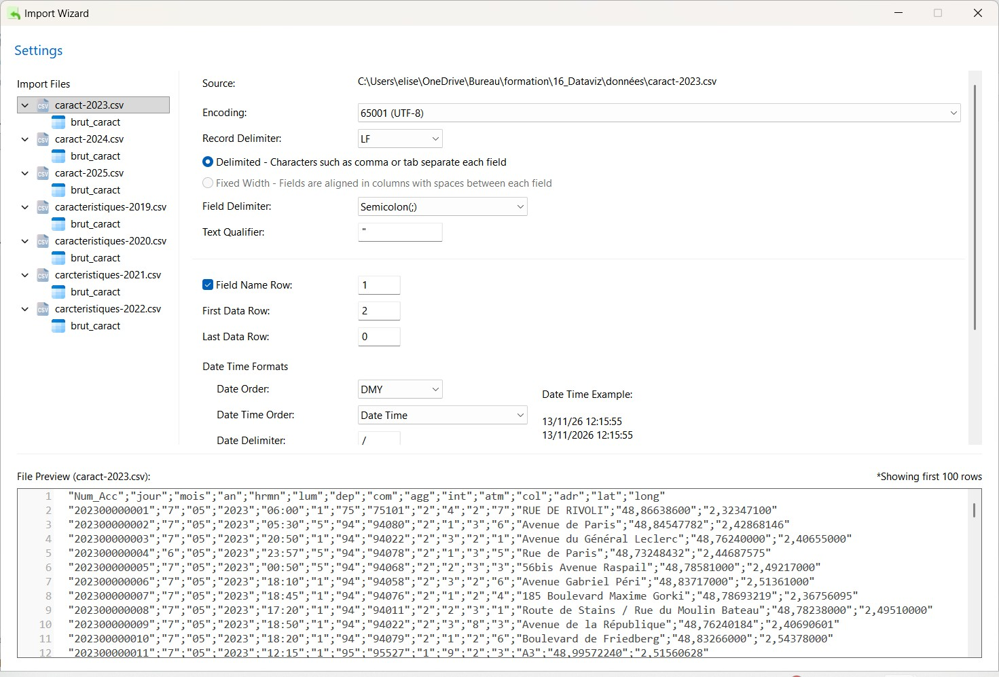
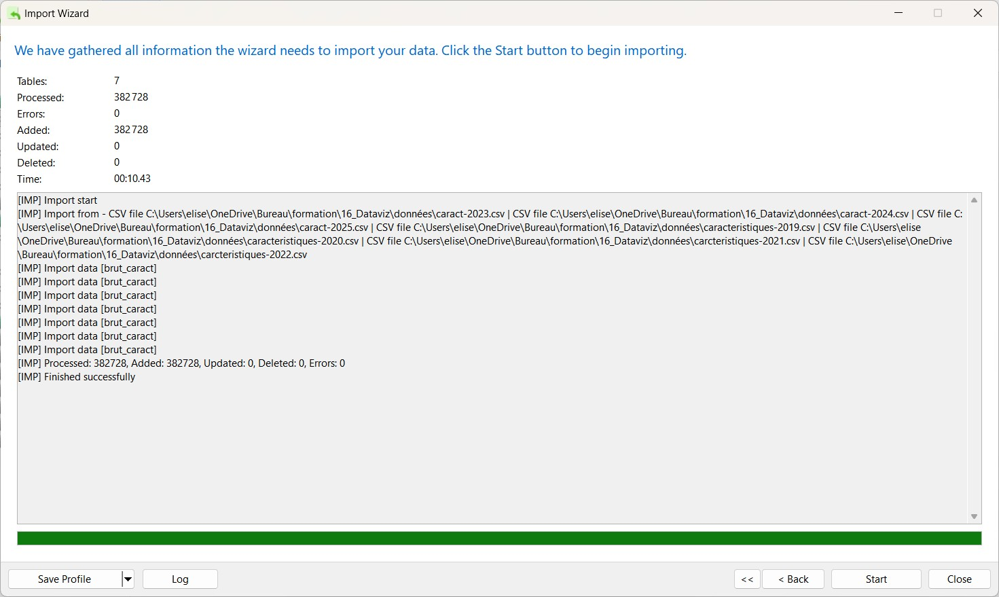
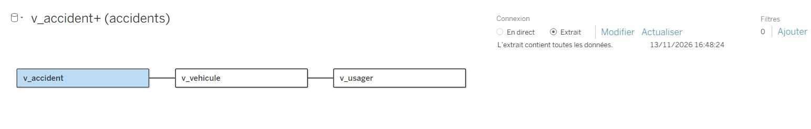
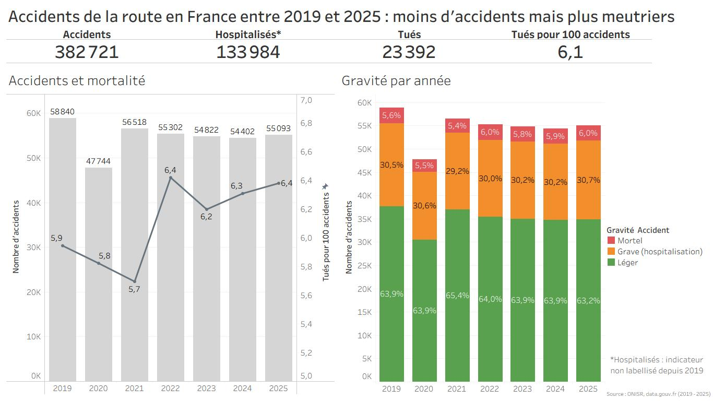
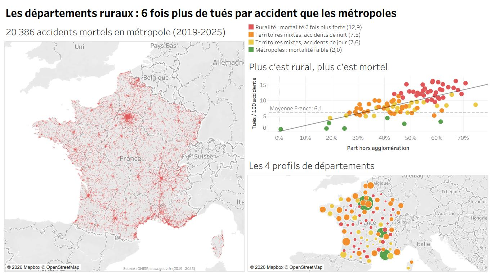
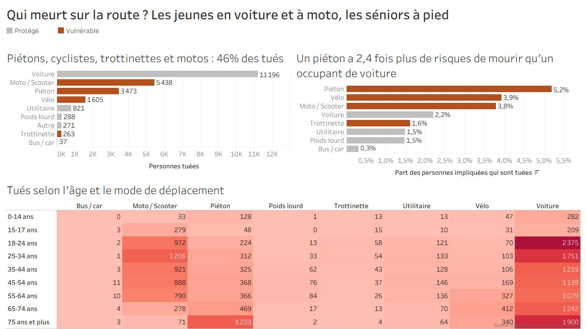
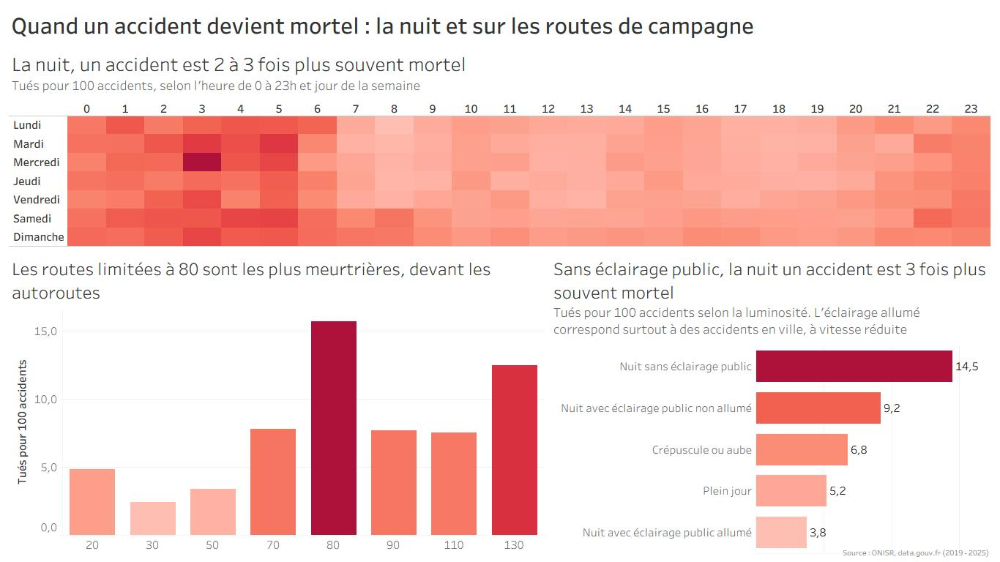
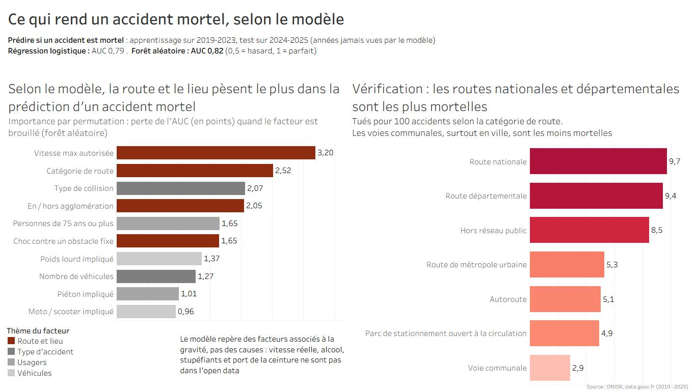
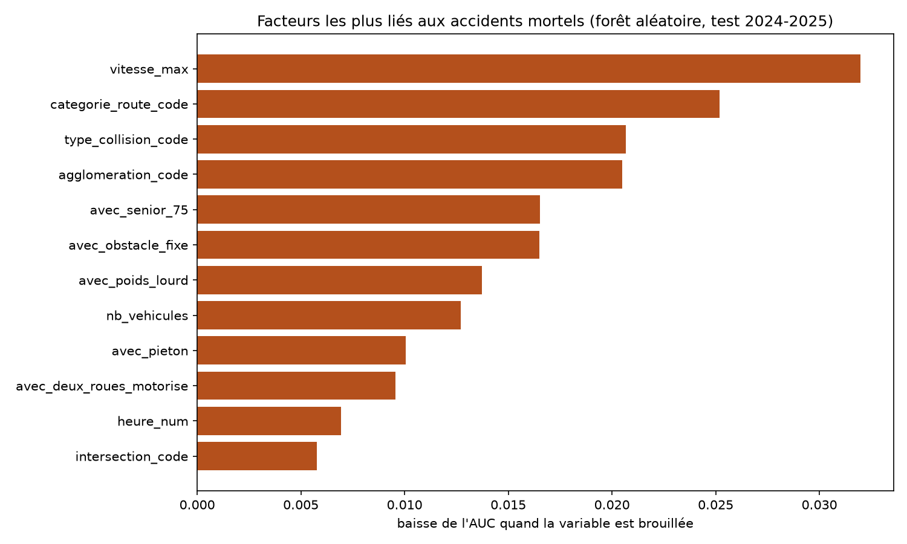

# Accidents de la route en France, 2019-2025

Projet de data visualisation réalisé dans le cadre de la formation data d'AJC.

**Objectif :** transformer une base open data brute en un outil utile, qui permet de repérer **où, quand et pour qui** la route est la plus dangereuse.

**Chaîne de traitement :** fichiers CSV open data → audit Python → base MySQL (import, nettoyage, vues) → connexion ODBC → tableaux de bord Tableau, avec deux algorithmes de machine learning (classification en Python, clustering dans Tableau).

**Auteure :** Élise Droneaud · Novembre 2026

---

## En bref

| | |
|---|---|
| **Question** | Où, quand et pour qui la route est-elle la plus dangereuse en France ? |
| **Données** | 382 721 accidents corporels 2019-2025 (ONISR, data.gouv.fr), 28 fichiers CSV |
| **Outils** | Python (audit, machine learning) · MySQL (nettoyage, modèle relationnel) · ODBC · Tableau (5 tableaux de bord, histoire de 7 pages) |
| **Résultats clés** | Moins d'accidents mais plus mortels (5,9 → 6,4 tués pour 100 accidents) · 6 fois plus mortel dans les départements ruraux que dans les métropoles · un piéton a 2,4 fois plus de risques de mourir qu'un occupant de voiture · la nuit, un accident est 2 à 3 fois plus souvent mortel |
| **Machine learning** | Forêt aléatoire (AUC 0,82) pour prédire un accident mortel · k-means pour une typologie des départements |
| **Présentation** | Classeur Tableau et PDF dans la Release v1.0 |

---

## Sommaire

1. [Source des données](#1-source-des-données)
2. [Architecture du projet](#2-architecture-du-projet)
3. [Prérequis et installation](#3-prérequis-et-installation)
4. [Audit de qualité des données (Python)](#4-audit-de-qualité-des-données-python)
5. [Stockage et nettoyage dans MySQL](#5-stockage-et-nettoyage-dans-mysql)
6. [Connexion à Tableau](#6-connexion-à-tableau)
7. [Les tableaux de bord](#7-les-tableaux-de-bord)
8. [Machine learning](#8-machine-learning)
9. [Résultats principaux](#9-résultats-principaux)
10. [Limites des données](#10-limites-des-données)
11. [Reproduire le projet](#11-reproduire-le-projet)

---

## 1. Source des données

| Élément | Détail |
|---|---|
| Jeu de données | *Bases de données annuelles des accidents corporels de la circulation routière – Années de 2005 à 2025* |
| Producteur | Observatoire national interministériel de la sécurité routière (ONISR), ministère de l'Intérieur |
| Plateforme | [data.gouv.fr](https://www.data.gouv.fr/datasets/bases-de-donnees-annuelles-des-accidents-corporels-de-la-circulation-routiere-annees-de-2005-a-2025) |
| Licence | Licence Ouverte / Open Licence (Etalab) |
| Date de téléchargement | 13/11/2026 |
| Période retenue | 2019 à 2025 (7 années) |
| Fichiers utilisés | 28 CSV (4 par année : caractéristiques, lieux, véhicules, usagers) + la documentation `description-des-bases-de-donnees-annuelles.pdf` |
| Format | CSV, séparateur `;`, encodage UTF-8 |

**Pourquoi 2019-2025 :** le format de la base a changé en 2019 (nouvelles variables, comme les trottinettes électriques, et nouveaux identifiants). Remonter plus loin aurait obligé à harmoniser deux formats différents.

**Volume (après nettoyage) :**

| Table | Une ligne = | Lignes |
|---|---|---|
| accident | un accident corporel | 382 721 |
| lieu | le lieu principal de l'accident | 382 721 |
| vehicule | un véhicule impliqué | 653 712 |
| usager | une personne impliquée | 871 534 |

Les données sont **quantitatives** (nombre de victimes, âge, vitesse maximale autorisée), **qualitatives** (gravité, type d'usager, météo, luminosité), **géographiques** (coordonnées GPS, département, commune) et **temporelles** (date et heure).

---

## 2. Architecture du projet

```
CSV open data (28 fichiers)
      │
      ├── python/audit_csv.py ──► audit_qualite.csv (anomalies détectées)
      │
      ▼
MySQL (base « accidents »)
  4 tables brutes ──► nettoyage SQL ──► 4 tables propres + 12 tables de libellés
                                              │
                                              ▼
                                     3 vues d'analyse
      │
      ├──► python/ml_gravite.py (compte en lecture seule)
      │      prédiction des accidents mortels
      │
      ▼  pilote ODBC (DSN « accidents_mysql », compte en lecture seule)
Tableau Desktop (source en extrait)
      │
      ▼
4 tableaux de bord (dont un clustering k-means) + une histoire de présentation
```

**Organisation du dépôt :**

```
projet-accidents-dataviz/
├── README.md
├── .gitignore
├── data/
│   └── README_data.md               (où télécharger les CSV : trop lourds pour GitHub)
├── python/
│   ├── audit_csv.py                 (audit de qualité des CSV, version script)
│   ├── audit_pas_a_pas.ipynb        (le même audit, commenté étape par étape)
│   ├── ml_gravite.py                (prédiction des accidents mortels, version script)
│   ├── ml_pas_a_pas.ipynb           (le même modèle, commenté étape par étape)
│   ├── requirements.txt             (bibliothèques Python nécessaires)
│   └── ml_resultats/                (métriques, importance des facteurs, graphique)
├── sql/
│   ├── 01_creation_base.sql         (base + tables brutes)
│   ├── 02_controles_import.sql      (lignes vides, comptages, index, orphelins)
│   ├── 03_nettoyage.sql             (tables propres, types, clés)
│   ├── 04_libelles.sql              (tables ref_ + clés étrangères)
│   ├── 05_vues_analyses.sql         (3 vues pour Tableau)
│   └── 06_utilisateur_lecture_seule.sql (compte pour Tableau et Python)
└── captures/                        (captures des tableaux de bord)
```

**Classeur Tableau et présentation :** le fichier `accidents_dataviz.twbx` (29 Mo, 5 tableaux de bord et une histoire de 7 pages) dépasse la limite de 25 Mo des fichiers du dépôt. Il est téléchargeable, avec la présentation en PDF, dans la **Release v1.0** du dépôt (colonne de droite de la page GitHub → *Releases*).

---

## 3. Prérequis et installation

| Outil | Version utilisée | Rôle |
|---|---|---|
| MySQL Server | 8.0.46 | Stockage des données |
| Navicat for MySQL | 18 | Import des CSV et exécution des scripts SQL |
| MySQL Connector/ODBC | 26.7 Unicode (64 bits) | Pilote pour connecter Tableau à MySQL |
| Tableau Desktop | Édition gratuite | Tableaux de bord |
| Python | 3.13 | Audit de qualité (pandas) et machine learning (scikit-learn) |
| Jupyter Notebook | — | Versions commentées pas à pas des scripts |

---

## 4. Audit de qualité des données (Python)

Avant l'import, le script `scripts/audit_csv.py` analyse automatiquement les 28 fichiers : nombre de lignes, noms de colonnes, doublons, cellules vides, valeurs `-1` (non renseigné), coordonnées GPS hors de France, plusieurs lieux par accident, espaces insécables dans les identifiants.

```
py -3.13 -m pip install -r python/requirements.txt
py -3.13 python/audit_csv.py "chemin/vers/le/dossier/des/csv"
```

Une version commentée étape par étape existe dans `python/audit_pas_a_pas.ipynb` (à ouvrir avec `py -3.13 -m notebook`).

Il produit un rapport `audit_qualite.csv` (une ligne par fichier).

**Anomalies détectées, et traitement appliqué ensuite en SQL :**

| Anomalie | Fichiers concernés | Traitement |
|---|---|---|
| Clé nommée `Accident_Id` au lieu de `Num_Acc` | caractéristiques 2022 | Renommée à l'import |
| Plusieurs lignes de lieux pour un même accident (≈ 15 800 par an) | lieux 2023-2025 | Premier lieu conservé, nombre d'origine gardé (`nb_lignes_source`) |
| Latitude et longitude inversées | 3 en 2024, 1 en 2025 | Remises dans le bon ordre |
| Coordonnées impossibles (11 ; 11) | 1 en 2019 | Mises à NULL, signalées « invalides » |
| Virgule décimale et espace dans les coordonnées | tous | Converties en nombres décimaux |
| Départements sans zéro (« 1 » au lieu de « 01 ») | caractéristiques 2019 (2 966 lignes) | Zéro ajouté |
| `-1` et cellules vides (= non renseigné) | tous | Remplacés par NULL |
| Vitesses maximales absurdes (500, 900 km/h…) | lieux (272 au total) | Mises à NULL (seules les valeurs de 5 à 130 km/h sont gardées) |
| Valeur « #VALEURMULTI » dans le nombre de voies | lieux 2022-2025 | Mise à NULL |
| Espaces insécables dans les identifiants (`155 975 242`) | véhicules, usagers | Supprimés, identifiants convertis en nombres |
| En-tête `id_vehicule` coupé par un retour à la ligne | véhicules 2025 | Colonne associée à la main à l'import |
| Colonne `id_usager` absente | usagers 2019-2020 | Clé technique auto-incrémentée créée |
| Années de naissance avant 1910 (191) | usagers | Mises à NULL ; l'âge est calculé ensuite |

---

## 5. Stockage et nettoyage dans MySQL

### 5.1 Création de la base et import

`sql/01_creation_base.sql` crée la base `accidents` et 4 tables **brutes**, où toutes les colonnes sont en texte, pour que l'import n'échoue jamais. Une colonne `ligne_id` auto-incrémentée garde l'ordre des lignes du fichier.

**Procédure d'import (Navicat, assistant d'import) :** une table à la fois, les 7 fichiers d'une même table en mode **Append**, avec les réglages : encodage UTF-8, séparateur `;`, délimiteur de texte `"`, en-tête en ligne 1, données à partir de la ligne 2, fin de ligne LF (CRLF pour les fichiers 2020).





### 5.2 Contrôles après import

`sql/02_controles_import.sql` :
- comptage des lignes par année et par table, comparé au nombre de lignes des CSV : **identique** pour les 28 fichiers ;
- suppression des lignes vides de fin de fichier (7 + 6 + 5 + 6) ;
- création d'index sur les clés de jointure ;
- recherche des lignes « orphelines » (un lieu sans accident, un usager sans véhicule…) : **0**.

### 5.3 Nettoyage et modèle relationnel

`sql/03_nettoyage.sql` crée 4 tables **propres**, typées, avec des noms de colonnes harmonisés et lisibles (`lum` → `luminosite`, `grav` → `gravite`…) :

| Table | Clé primaire | Clés étrangères |
|---|---|---|
| accident | `Num_Acc` | — |
| lieu | `Num_Acc` | `Num_Acc` → accident |
| vehicule | `id_vehicule` | `Num_Acc` → accident |
| usager | `id_usager_cle` (auto-incrémentée) | `Num_Acc` → accident, `id_vehicule` → vehicule |

`sql/04_libelles.sql` ajoute **12 tables de libellés** (`ref_gravite`, `ref_categorie_vehicule`, `ref_luminosite`…), recopiées de la documentation officielle, et les relie par clés étrangères. La table `ref_categorie_vehicule` regroupe les 31 catégories officielles en **8 familles** lisibles (Vélo, Trottinette / EDP, Deux-roues motorisé, Voiture…). Contrôle : aucun code des données sans libellé.

Les tables brutes ne sont jamais modifiées : tout le nettoyage peut être relancé.

### 5.4 Vues d'analyse

`sql/05_vues_analyses.sql` crée 3 vues, chacune à **son propre niveau de détail** (pour éviter tout double comptage) :

| Vue | Une ligne = | Contenu ajouté |
|---|---|---|
| `v_accident` | un accident | lieu, libellés, jour de la semaine, bilan humain (`nb_tues`…), gravité de l'accident (Mortel / Grave / Léger) |
| `v_vehicule` | un véhicule | catégorie et famille du véhicule |
| `v_usager` | une personne | libellés, type d'usager (Piéton ou famille du véhicule), tranche d'âge, indicateurs 0/1 (`est_tue`…) |

Contrôle : les vues ont exactement le même nombre de lignes que les tables d'origine (382 721 / 653 712 / 871 534).

---

## 6. Connexion à Tableau

1. Création d'un **utilisateur MySQL en lecture seule**, `tableau_user`, utilisé par Tableau et par Python (`sql/06_utilisateur_lecture_seule.sql`, `GRANT SELECT ON accidents.*`) : les outils d'analyse ne peuvent rien modifier. Le compte `root` reste réservé à l'administration dans Navicat.
2. Création d'une source de données ODBC Windows (64 bits) : DSN `accidents_mysql`, pilote **MySQL ODBC 26.7 Unicode Driver**, serveur `localhost`, port `3306`, base `accidents`. Test de connexion réussi.
3. Dans Tableau : connecteur MySQL, base `accidents`, modèle construit avec des **relations** (et non des jointures) entre les 3 vues :

```
v_accident ── v_vehicule ── v_usager
   (Num_Acc)        (id_vehicule)
```



4. Source passée en **extrait** (.hyper) : chaque requête directe sur les vues prenait 6 à 7 secondes ; l'extrait rend les tableaux de bord fluides et reste actualisable depuis MySQL (*Données → Actualiser l'extrait*).

**Vérification de cohérence :** le nombre de tués par type d'usager calculé dans Tableau est identique à celui obtenu en SQL (total : 23 392).

Les identifiants de connexion ne figurent pas dans ce dépôt.

---

## 7. Les tableaux de bord

Le classeur contient **5 tableaux de bord** (1366 × 768) et une **histoire** de 7 pages qui sert de support de présentation : introduction, les 5 tableaux de bord, conclusion. Règles communes : chaque titre énonce le constat du graphique, plus la couleur est foncée plus c'est mortel, chaque tableau de bord indique sa source, et les infobulles sont rédigées en phrases.

**Champs calculés principaux :**

| Champ | Formule Tableau | Rôle |
|---|---|---|
| Tués pour 100 accidents | `SUM([Nb Tues]) / COUNTD([Num Acc]) * 100` | gravité d'un accident |
| Part hors agglomération | `AVG(IIF([Agglomeration Code] = 1, 1, 0))` | proxy de la ruralité |
| Part de nuit | `AVG(IIF([Luminosite Code] >= 3, 1, 0))` | accidents de nuit |
| Part des usagers tués | `AVG([Est Tue])` | risque individuel par type d'usager |
| Vulnérabilité | piéton, vélo, trottinette ou moto → « Vulnérable », sinon « Protégé » | mise en couleur |

### Tableau de bord 1 : Vue d'ensemble — « Moins d'accidents, plus mortels »
- **Question :** combien d'accidents et de victimes, et comment ça évolue depuis 2019 ?
- **Indicateurs :** 382 721 accidents · 23 392 tués · 133 984 hospitalisés\* · 6,1 tués pour 100 accidents
- **Graphiques :** accidents par année (barres) et tués pour 100 accidents (courbe) sur un **double axe** ; répartition des accidents par gravité et par année (barres empilées en %)
- **Interactivité :** un clic sur une année filtre tout le tableau de bord ; surbrillance de l'année au survol
- **Lecture :** les accidents baissent (58 840 en 2019, 55 093 en 2025), pas les tués (3 498 puis 3 515) : de **5,9 à 6,4 tués pour 100 accidents**. La part d'accidents mortels passe de 5,6 % à 6,0 %.

\*Indicateur non labellisé par la statistique publique depuis 2019 (voir limites).



### Tableau de bord 2 : Territoires — « 6 fois plus mortel à la campagne »
- **Question :** où meurt-on sur la route, et quels types de territoires sont les plus dangereux ?
- **Graphiques :**
  - carte des **20 386 accidents mortels** de métropole (un point par accident) ;
  - nuage de points des 96 départements : part d'accidents hors agglomération × tués pour 100 accidents, avec **droite de tendance** et ligne de la moyenne nationale (6,1) ;
  - carte des départements colorés selon leur **groupe k-means** (section 8.2), taille des points = nombre d'accidents.
- **Interactivité :** un clic sur un groupe de la légende l'isole sur les deux cartes ; surbrillance du département au survol
- **Lecture :** la part d'accidents hors agglomération explique près de la moitié des écarts de mortalité entre départements (**R² = 0,49, p < 0,0001**) : 10 points de plus, c'est environ 2 tués de plus pour 100 accidents. Les départements ruraux comptent **12,9 tués pour 100 accidents**, contre **2,0** pour les grandes métropoles et l'Île-de-France : **6 fois plus**.



### Tableau de bord 3 : Usagers vulnérables — « Jeunes à moto, seniors à pied »
- **Question :** qui meurt sur la route, et qui court le plus de risques ?
- **Graphiques :**
  - tués par type d'usager, usagers vulnérables en couleur ;
  - part des personnes impliquées qui sont tuées, par type d'usager ;
  - carte de chaleur des tués par tranche d'âge et mode de déplacement.
- **Lecture :**
  - les usagers vulnérables représentent **46 % des tués** (10 779) ;
  - un **piéton** impliqué dans un accident a **2,4 fois plus de risques de mourir** qu'un occupant de voiture (5,2 % contre 2,2 %), un cycliste 1,8 fois plus ;
  - deux profils de victimes : les **jeunes en voiture et à moto** (2 375 tués de 18-24 ans en voiture, 1 206 de 25-34 ans à moto) et les **seniors à pied** (1 233 piétons tués de 75 ans et plus).
  - Fait inattendu : rapportées au nombre d'impliqués, les trottinettes sont moins mortelles que les voitures (1,6 % contre 2,2 %).



### Tableau de bord 4 : Circonstances — « La nuit et à 80 km/h »
- **Question :** quand et dans quelles conditions un accident devient-il mortel ?
- **Graphiques :** carte de chaleur heure × jour (tués pour 100 accidents) ; gravité selon la vitesse maximale autorisée (vitesses de plus de 1 000 accidents) ; gravité selon la luminosité
- **Lecture :**
  - la nuit, un accident est **2 à 3 fois plus souvent mortel** (environ 4 à 5 tués pour 100 accidents le jour, 10 à 15 la nuit), surtout le week-end ;
  - les routes limitées à **80 km/h** sont les plus mortelles (environ 15,7 tués pour 100 accidents), devant les **autoroutes** à 130 km/h (environ 12,5) ;
  - la **nuit sans éclairage public** est près de 3 fois plus mortelle que le plein jour (14 contre 5).
- **Précaution :** les cases de nuit regroupent peu d'accidents, une case isolée peut donc varier par hasard ; c'est la bande de nuit dans son ensemble qui compte. La vitesse est la vitesse **autorisée**, pas la vitesse réelle.



### Tableau de bord 5 : Machine learning — « Ce que prédit le modèle »
- **Question :** quels facteurs permettent de prédire qu'un accident sera mortel ?
- **Graphiques :** les 10 facteurs les plus importants pour la forêt aléatoire (perte d'AUC en points quand le facteur est brouillé), colorés par thème ; vérification dans les données brutes avec la gravité par catégorie de route
- **Lecture :** la route et le lieu dominent (vitesse maximale autorisée, catégorie de route, agglomération, obstacle fixe). La vérification confirme : routes nationales (9,7) et départementales (9,4) sont les plus mortelles, les voies communales les moins (2,9). Le modèle retrouve ainsi ce que montrent les tableaux de bord 2, 3 et 4.



---

## 8. Machine learning

Deux algorithmes, deux usages différents : l'un **prédit**, l'autre **regroupe**.

### 8.1 Classification : prédire si un accident est mortel (Python)

`python/ml_gravite.py` (et sa version commentée `python/ml_pas_a_pas.ipynb`) lit les données dans MySQL avec le compte en lecture seule, puis construit une ligne par accident avec ses caractéristiques : lieu (hors agglomération, catégorie de route, vitesse maximale, intersection, virage, pente, état de la chaussée), moment (mois, jour, heure, luminosité, météo), type de collision, véhicules impliqués (vélo, trottinette, deux-roues motorisé, poids lourd, obstacle fixe) et usagers (piéton, personne de 75 ans et plus, jeune de 18 à 24 ans, nombre d'usagers).

| Élément | Choix |
|---|---|
| Cible | accident mortel (1) ou non (0) : 5,8 % des accidents |
| Découpage | **apprentissage 2019-2023, test 2024-2025** : on vérifie que le modèle prédit des années qu'il n'a jamais vues |
| Modèle de référence | régression logistique (variables codées en one-hot et standardisées) |
| Modèle retenu | forêt aléatoire (300 arbres, classes rééquilibrées car les accidents mortels sont rares) |
| Mesure | AUC ROC (0,5 = hasard, 1 = parfait), adaptée aux classes déséquilibrées |

**Résultats sur 2024-2025 :** régression logistique **AUC = 0,791** · forêt aléatoire **AUC = 0,819**.

**Facteurs les plus importants** (perte d'AUC en points quand le facteur est brouillé) :

| Rang | Facteur | Perte d'AUC (points) |
|---|---|---|
| 1 | Vitesse maximale autorisée | 3,20 |
| 2 | Catégorie de route | 2,52 |
| 3 | Type de collision | 2,07 |
| 4 | En / hors agglomération | 2,05 |
| 5 | Personne de 75 ans ou plus impliquée | 1,65 |
| 6 | Choc contre un obstacle fixe | 1,65 |
| 7 | Poids lourd impliqué | 1,37 |
| 8 | Nombre de véhicules | 1,27 |
| 9 | Piéton impliqué | 1,01 |
| 10 | Moto / scooter impliqué | 0,96 |

Ces résultats sont importés dans Tableau (`importance_variables.csv`) pour le tableau de bord 5.



L'**importance par permutation** mesure de combien l'AUC baisse quand on mélange une variable au hasard : plus la baisse est forte, plus le facteur compte. Graphique : `python/ml_resultats/importance_variables.png`.

**Limite :** le modèle repère des facteurs **associés** à la gravité, pas des causes. Il ne connaît pas la vitesse réelle, l'alcool ni la ceinture, absents de l'open data.

### 8.2 Clustering k-means : une typologie des départements (Tableau)

Chaque département de métropole est décrit par 3 indicateurs, calculés dans Tableau :

| Indicateur | Formule Tableau |
|---|---|
| Tués pour 100 accidents | `SUM([Nb Tues]) / COUNTD([Num Acc]) * 100` |
| Part hors agglomération | `AVG(IIF([Agglomeration Code] = 1, 1, 0))` |
| Part de nuit | `AVG(IIF([Luminosite Code] >= 3, 1, 0))` |

Le k-means de Tableau (*Analytique → Cluster*, variables normalisées) a été appliqué aux **96 départements** d'au moins 100 accidents. Les départements de moins de 100 accidents sont exclus, car un taux calculé sur quelques cas n'est pas fiable. Il s'agit de quelques accidents d'outre-mer dont les coordonnées erronées tombent en métropole.

**Choix du nombre de groupes :** Tableau proposait automatiquement 2 groupes. 4 groupes expliquent **64 %** de la variance (somme des carrés entre les groupes ÷ somme totale = 8,30 ÷ 12,97), contre 55 % pour 3 groupes, et c'est le seul découpage qui isole les grandes métropoles.


| Groupe | Départements | Tués pour 100 accidents | Hors agglomération | Nuit |
|---|---|---|---|---|
| Métropoles : mortalité faible | 8 (75, 92, 93, 91, 95, 69, 13…) | 2,0 | 30 % | 29 % |
| Territoires mixtes, accidents de jour | 22 | 7,6 | 47 % | 21 % |
| Territoires mixtes, accidents de nuit | 31 | 7,5 | 41 % | 27 % |
| Ruralité : mortalité 6 fois plus forte | 35 | 12,9 | 58 % | 25 % |

Un premier essai de clustering sur les seules coordonnées GPS des accidents a été abandonné : il découpait la France en 8 zones proches des régions, sans rien apprendre de nouveau.

---

## 9. Résultats principaux

Chiffres calculés en SQL et vérifiés dans Tableau (France entière, 2019-2025) :

- **382 721** accidents corporels, dont **22 021 mortels** (5,8 %).
- **23 392** personnes tuées, **133 984** blessées hospitalisées.
- Personnes tuées par type d'usager : voiture 11 196 · deux-roues motorisé 5 438 · **piéton 3 473** · vélo 1 605 · utilitaire 821 · poids lourd 288 · trottinette / EDP 263 · transport en commun 37 · autre 271.
- Le nombre d'accidents mortels reste compris entre 3 000 et 3 350 par an, sauf en 2020 (2 616, année du confinement).
- Les accidents baissent, pas les tués : de **5,9 à 6,4 tués pour 100 accidents** entre 2019 et 2025.
- Les usagers vulnérables (piétons, vélos, trottinettes, deux-roues motorisés) représentent **46 % des tués** (10 779).
- Un accident dans un département rural est en moyenne **6 fois plus meurtrier** que dans une grande métropole (12,9 contre 2,0 tués pour 100 accidents).
- Un piéton impliqué dans un accident a 2,4 fois plus de risques de mourir qu'un occupant de voiture.
- La nuit, un accident est 2 à 3 fois plus souvent mortel ; les routes limitées à 80 km/h sont les plus mortelles.
- Le modèle de machine learning (AUC 0,82) confirme le poids de la route et du lieu.

**Pistes d'action :** aménager les routes de campagne (obstacles, éclairage), protéger les piétons âgés et les jeunes conducteurs, renforcer la prévention de nuit.

---

## 10. Limites des données

- **Champ :** seuls les accidents **corporels** (au moins un blessé ou un tué), impliquant au moins un véhicule et **constatés par les forces de l'ordre** sont recensés. Les accidents matériels et les chutes de piétons seuls n'y figurent pas.
- **Lieu ≠ résidence :** le département est celui du **lieu de l'accident**, pas celui où vivent les victimes. Les départements touristiques ou traversés par de grands axes sont surreprésentés.
- **Données retirées :** selon la documentation officielle (avis de la CADA du 2 janvier 2012), l'open data masque les données sur le comportement des usagers pour protéger leur vie privée : **alcool, stupéfiants, vitesse réelle, port de la ceinture** n'y figurent pas. Le machine learning repère donc des facteurs **associés** à la gravité, pas des causes.
- **« Blessé hospitalisé » :** depuis 2019, cet indicateur n'est plus labellisé par l'autorité de la statistique publique (il est déclaré par les forces de l'ordre). Le chiffre de 133 984 hospitalisés est à lire avec prudence.
- **Usagers en fuite :** depuis 2021, ils sont ajoutés à la base, souvent sans âge ni sexe, ce qui augmente les valeurs manquantes.
- **2020 est atypique** (confinement) : la baisse de cette année ne traduit pas une amélioration de la sécurité routière.
- **Précision GPS variable :** la carte permet de repérer des zones, pas l'emplacement exact d'un accident au mètre près.
- **Valeurs non renseignées :** une part des variables est manquante (par exemple 28 % des motifs de trajet des conducteurs).
- **Pas de données d'exposition** (kilomètres parcourus, trafic) : on compare des nombres d'accidents, pas des risques.
- **Outre-mer :** les coordonnées GPS n'ont été contrôlées que pour la métropole ; quelques accidents d'outre-mer ont des coordonnées erronées. Les cartes et la typologie se limitent à la métropole.
- **Colonnes non conservées :** les colonnes de lieux peu utiles à l'analyse (`v1`, `v2`, `pr`, `pr1`, `lartpc`, `larrout`) n'ont pas été reprises dans les tables propres. Les codes `0` (souvent « sans objet ») ont été conservés.
- **Changement de format en 2019 :** les années antérieures ne sont pas directement comparables et n'ont pas été intégrées.

---

## 11. Reproduire le projet

1. Télécharger les 28 CSV 2019-2025 depuis la page data.gouv.fr indiquée en section 1 (voir `data/README_data.md`).
2. Installer les bibliothèques (`py -3.13 -m pip install -r python/requirements.txt`) et lancer l'audit : `py -3.13 python/audit_csv.py "dossier_des_csv"`.
3. Dans Navicat (ou MySQL Workbench), exécuter `sql/01_creation_base.sql`.
4. Importer les CSV dans les 4 tables brutes avec les réglages de la section 5.1.
5. Exécuter dans l'ordre `02_controles_import.sql`, `03_nettoyage.sql`, `04_libelles.sql`, `05_vues_analyses.sql`, en comparant les résultats aux valeurs indiquées en commentaire.
6. Créer le compte en lecture seule (`06_utilisateur_lecture_seule.sql`, en choisissant un mot de passe) et le DSN ODBC (section 6).
7. Lancer le machine learning : `py -3.13 python/ml_gravite.py` (le mot de passe est demandé au lancement).
8. Télécharger `accidents_dataviz.twbx` depuis la Release v1.0, l'ouvrir dans Tableau, modifier la connexion si besoin, puis actualiser l'extrait.
